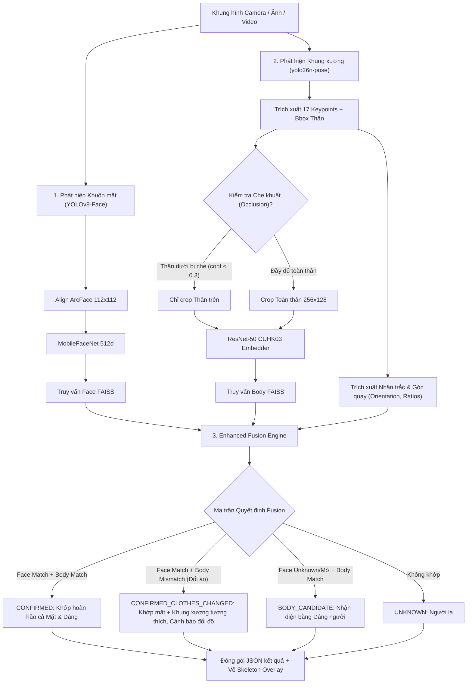

# KẾ HOẠCH TÍCH HỢP TOÀN DIỆN MODULE SKELETON / POSE (`yolo26n-pose.pt`)

> **Phiên bản**: 2.0 (Toàn diện Full-stack: ML Service + Core Service + Frontend)  
> **Nhánh thực hiện**: `feature/skeleton-pose-integration`  
> **Mục tiêu**: Bổ sung năng lực Skeleton / Pose Estimation nhằm giải quyết triệt để các hạn chế của module Re-ID (thay đổi trang phục, che khuất, góc nhìn biến dạng) xuyên suốt cả 3 tầng hệ thống (**ML Service**, **Backend Core Service**, và **Frontend React**) mà **hoàn toàn không làm gián đoạn hay ảnh hưởng** đến các tính năng hiện tại.

---

## 1. Phân tích bài toán & Hạn chế của Module Re-ID hiện tại

Hệ thống hiện tại đang sử dụng mô hình **ResNet-50 CUHK03 (Re-ID)** kết hợp **YOLOv8n Body Detector**. Mặc dù Re-ID hoạt động tốt trong điều kiện lý tưởng, mô hình Re-ID thuần dựa trên ngoại hình (appearance-based) bộc lộ nhiều điểm yếu cố hữu:

| Hạn chế của Re-ID hiện tại | Nguyên nhân cốt lõi | Rủi ro trong bài toán thực tế |
|---|---|---|
| **Thay đổi trang phục (Clothes Change)** | Re-ID phụ thuộc phần lớn vào màu sắc, hoa văn áo quần. Khi đối tượng thay áo/mặc áo khoác, độ tương đồng tụt dốc. | Bị bỏ lọt đối tượng (False Negative). |
| **Bị che khuất (Occlusion)** | Người đi sau chướng ngại vật (quầy kệ, xe cộ, người khác che nửa dưới) làm crop body bị khuyết. | ResNet-50 trích xuất vector méo mó, match sai người. |
| **Biến dạng góc nhìn & Tư thế (Viewpoint & Pose Variations)** | Người quay lưng, cúi gập, ngồi hoặc góc camera từ trên cao xuống (CCTV oblique angle) làm tỉ lệ cơ thể thay đổi. | Độ tương đồng thấp do không chuẩn hóa được tư thế. |
| **Gắn kết Face và Body (Association) lỏng lẻo** | Hiện dùng heuristic hình học (bbox tâm/containment) trong `fusion.py`, dễ gán nhầm mặt người A vào thân người B khi đứng chen chúc. | Gây sai lệch kết quả hợp nhất (Fusion). |

---

## 2. Sự phù hợp của `yolo26n-pose.pt` với hệ thống

Mô hình `yolo26n-pose.pt` là dòng **YOLO Pose Nano** (Ultralytics), đã được kiểm tra thực nghiệm trực tiếp trong môi trường hệ thống:
- **Tham số**: 3,679,464 params (~3.68M).
- **FLOPs**: 10.4 GFLOPs.
- **Tốc độ & Tài nguyên**: Cực kỳ nhẹ, tiêu thụ < 25MB RAM, tốc độ tương đương `yolov8n.pt` đang dùng, suy luận mượt mà trên cả CPU thường.
- **Tính tương thích thư viện**: 100% (môi trường `ml-service/venv` đã có sẵn `ultralytics`, `torch`, `torchvision`).

### Module Skeleton bù đắp hạn chế của Re-ID như thế nào?
1. **Loại bỏ ảnh hưởng của trang phục (Invariance to Appearance)**:
   - Skeleton trích xuất **tỉ lệ khung xương nhân trắc học (Anthropometric / Biometric proportions)**: Tỉ lệ chiều dài chi (cẳng chân/đùi, sải vai/chiều cao, tỉ lệ lưng/chân). Các thông số hình học này **không thay đổi** dù người đó có thay áo khoác hay đổi màu quần.
2. **Xử lý che khuất (Occlusion Awareness)**:
   - 17 keypoints trả về kèm điểm tin cậy `conf`. Nếu các điểm chân (`left/right ankle, knee`) có `conf < 0.3`, hệ thống biết ngay người đang bị che thân dưới -> tự động chuyển sang chế độ Re-ID thân trên (Upper-body Re-ID) thay vì nhét cả crop lỗi vào mô hình.
3. **Chuẩn hóa góc nhìn & Tư thế (Pose Normalization)**:
   - Dựa vào vị trí 2 mắt, 2 tai và 2 vai, xác định chính xác góc nghiêng cơ thể (Front, Back, Side-left, Side-right) để đối sánh Re-ID theo đúng nhóm góc quay.
4. **Gắn kết Mặt - Thân (Face-Body Association) chuẩn xác tuyệt đối**:
   - Thay vì tính tâm bbox thô sơ, kiểm tra điểm **mũi, mắt, tai** của Skeleton có khớp với Bbox của Face Detector hay không. Khử hoàn toàn lỗi ghép nhầm người ở đám đông.

---

## 3. Có mô hình nào tốt hơn `yolo26n-pose.pt` không? So sánh chi tiết

| Mô hình | Ưu điểm | Nhược điểm | Đánh giá với hệ thống hiện tại |
|---|---|---|---|
| **`yolo26n-pose.pt`** *(Đang có)* | - Siêu nhẹ (~3.68M params, 10.4 GFLOPs). - Tốc độ thời gian thực (Real-time CPU/GPU). - Tích hợp 1-click qua `ultralytics`. | - Độ chính xác keypoints ở độ phân giải siêu thấp (camera xa) ở mức khá. | ⭐ **Phù hợp nhất giai đoạn này (Tối ưu CPU & độ trễ thấp)**. |
| **YOLOv8s-pose / YOLOv8m-pose** | - Độ chính xác keypoints cao hơn nano (AP tăng ~4-8%). - Nhận diện tốt hơn người ở xa/mờ. | - Nặng hơn (11M - 26M params), FLOPs cao hơn gấp 3 - 8 lần. - Tốn tài nguyên hơn nếu chạy đa luồng camera trên CPU. | 💡 **Lựa chọn nâng cấp tốt nhất khi có GPU chuyên dụng**. |
| **RTMPose (OpenMMLab)** | - SOTA về độ chính xác pose 2D thời gian thực. - Bắt keypoints cực kỳ chuẩn cả khi chen chúc. | - Cần cài đặt hệ sinh thái `mmcv`, `mmpose`, `onnxruntime` phức tạp, dễ xung đột môi trường hiện tại. | ⚠️ Không tối ưu cho việc tích hợp nhanh, dễ gây lỗi dependency. |
| **MediaPipe Pose** | - Chạy CPU cực nhanh, hỗ trợ 33 keypoints 3D. | - Tối ưu cho ảnh đơn người chụp gần (selfie/thể thao), rất kém khi áp dụng cho camera giám sát góc rộng có nhiều người. | ❌ Không phù hợp cho bài toán camera an ninh. |
| **Gait Recognition (GaitSet / GaitGL - Nhận diện dáng đi)** | - Khắc phục hoàn toàn bài toán thay đổi quần áo bằng chuỗi video bước đi. | - Đòi hỏi chuỗi video liên tục (Sequence of silhouettes), không thể áp dụng cho ảnh đơn (single image) của API hiện tại. | 📌 Có thể xem xét ở giai đoạn 2 cho luồng Video Streaming. |

---

## 4. Kiến trúc luồng phát hiện đa phương thức (Detection Flow)

Luồng xử lý mới phân nhánh thông minh, kết hợp cả 3 nguồn đặc trưng: **Face (Mặt)** + **Body Re-ID (Thân)** + **Skeleton (Khung xương)**:

---

## 5. Kế hoạch chi tiết theo từng tầng (ML, BE, FE)

### Tầng 1: ML Service (Python - FastAPI)
1. **Module `app/skeleton/` (Đã hoàn thành cấu trúc cốt lõi)**:
   - `skeleton_detector.py`: Nạp mô hình Singleton `yolo26n-pose.pt`, phát hiện bbox và 17 keypoints.
   - `feature_extractor.py`: Tính toán tỉ lệ nhân trắc (bất biến màu áo), góc nhìn (`FRONT/BACK/SIDE`), độ che khuất (`occlusion`).
   - `router.py`: Cung cấp API riêng biệt:
     - `POST /ml/skeleton/detect`: Trả về JSON keypoints và kết quả phân tích.
     - `POST /ml/skeleton/visualize`: Trả về ảnh vẽ khung xương dạng base64.
2. **Nâng cấp an toàn cho `app/main.py`**:
   - Khai báo thêm router: `app.include_router(skeleton_router, prefix="/ml/skeleton", tags=["Skeleton"])`.
   - Giữ nguyên 100% các endpoint `/ml/detect-and-match`, `/ml/register-face`.
   - Bổ sung endpoint hợp nhất mở rộng (Opt-in): `POST /ml/detect-and-match-v2` (tích hợp Skeleton vào Fusion, endpoint cũ giữ nguyên để BE gọi fallback).

---

### Tầng 2: Backend Core Service (Java - Spring Boot)

1. **DTOs mới (trong package `com.example.coreservice.dto`)**:
   - `KeypointDto.java`: `(id, name, x, y, conf)`
   - `SkeletonAnalysisDto.java`: `(orientation, isUpperOccluded, isLowerOccluded, shoulderToTorsoRatio, torsoToLegRatio)`
   - Cập nhật `FusionComponentResultDto.java`: Bổ sung thêm trường `List<KeypointDto> skeletonKeypoints` và `SkeletonAnalysisDto skeletonAnalysis` (để null nếu không bật skeleton, không gãy API cũ).
2. **Client gọi ML Service (`MlServiceClient.java`)**:
   - Bổ sung phương thức `detectSkeleton(MultipartFile file)` gọi tới `/ml/skeleton/detect`.
   - Bổ sung overload `detectFusion(MultipartFile file, boolean enableSkeleton)`.
3. **Controller & Service (`DetectionController.java` & `DetectionService.java`)**:
   - Thêm tham số truy vấn: `enableSkeleton` (mặc định `false` để giữ nguyên tương thích ngược).
   - Nếu `enableSkeleton = true`, Core Service nhận dữ liệu khung xương và đóng gói trả về cho Frontend.
   - Lưu trữ log: Cập nhật entity `LogPhatHien` thêm trường lưu thông tin góc quay và trạng thái khung xương (nếu cần truy vết).

---

### Tầng 3: Frontend (React + Vite)

1. **API Service (`src/services/api.js`)**:
   - Tự động nhận dữ liệu khung xương `skeletonKeypoints` và `skeletonAnalysis` trả về từ Backend mà không cần cờ bật/tắt thủ công.
   - Giữ nguyên các hàm `detectFusion` và `detectFusionVideo`.
2. **Giao diện Giám sát (`src/components/CameraMonitor.jsx`)**:
   - **Thanh điều khiển (Controls)**: **Không cần nút bật/tắt (Toggle switch)**. Hệ thống được tích hợp sẵn mặc định (Always-On Native Skeleton), tự động kích hoạt và hiển thị khung xương khi phát hiện người mà không cần người dùng thao tác thủ công.
   - **Vẽ Overlay Canvas (`drawDetections`)**:
     - Khi nhận diện thấy người, tự động vẽ các đường nối xương (xanh neon/cam) và các khớp tròn đỏ lên trên video/ảnh.
     - Tự động hiển thị các huy hiệu/nhãn thông minh theo ngữ cảnh:
       - `👤 Khớp mặt & dáng` (Màu xanh lá - Confirmed)
       - `⚠️ Nghi vấn đổi áo` (Màu vàng cam - Khớp mặt + Khung xương tương thích nhưng màu áo khác)
       - `🔄 Quay lưng / Bị che thân dưới` (Màu tím - Nhận diện dựa vào dáng/tỉ lệ nhân trắc)
3. **Bảng Lịch sử Tìm kiếm (`src/components/DetectionLogs.jsx`)**:
   - Lưu trữ và tự động hiển thị ảnh chụp kèm khung xương skeleton trong phần chi tiết bằng chứng phát hiện.

---

## 6. Lộ trình triển khai không gây rủi ro (Step-by-step Timeline)

| Bước | Thành phần | Nội dung công việc | Trạng thái |
|---|---|---|---|
| **B1** | **ML Service** | Đăng ký `skeleton_router` vào `ml-service/app/main.py`. Tích hợp Skeleton vào Fusion pipeline (`/ml/detect-and-match`). | ✅ **Đã nạp model & Verify 14 routes** |
| **B2** | **Backend Core** | Bổ sung DTOs (`KeypointDto`, `SkeletonAnalysisDto`) và mapper trong `MlServiceClient.java`. Mặc định xử lý Skeleton trong luồng phát hiện. | ⏳ **Sẵn sàng triển khai** |
| **B3** | **Frontend** | Tích hợp sẵn luồng vẽ Skeleton Canvas trong `CameraMonitor.jsx` (Always-On mặc định, không cần nút bật/tắt thủ công). | ⏳ **Sẵn sàng triển khai** |
| **B4** | **Kiểm thử E2E** | Test webcam trực tiếp, test ảnh đổi trang phục, kiểm tra độ mượt FPS. | ⏳ **Sẵn sàng triển khai** |

---

## 7. Kế hoạch Phục hồi (Rollback Plan)

Nếu có bất kỳ vấn đề phát sinh:
1. **Frontend**: Quay về bản vẽ Bounding Box cơ bản (bỏ qua bước render keypoints).
2. **Backend**: Không map các trường skeleton sang response DTO.
3. **ML Service**: Xóa dòng đăng ký `skeleton_router` trong `main.py` -> Trở về trạng thái ban đầu ngay lập tức.
